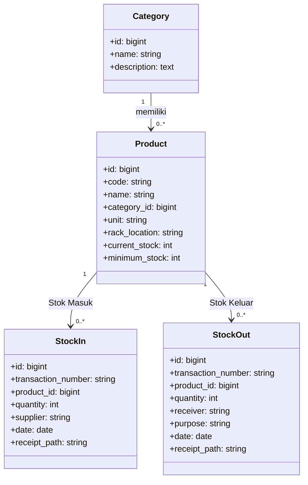
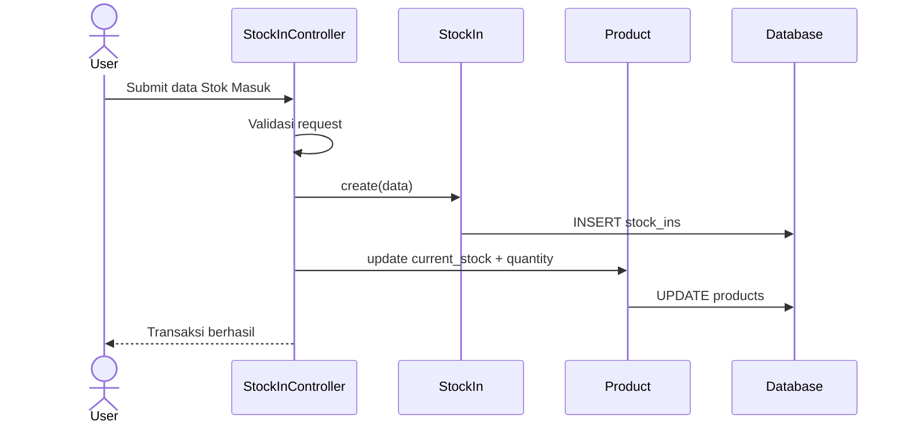
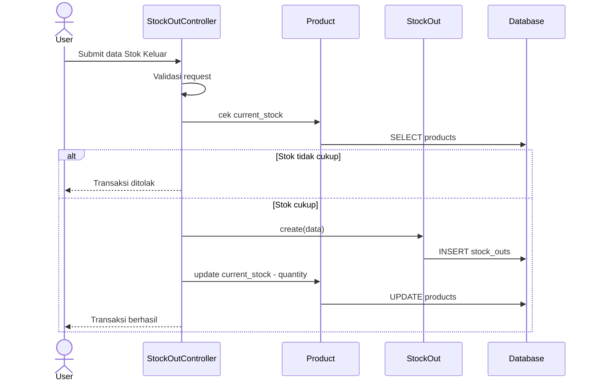
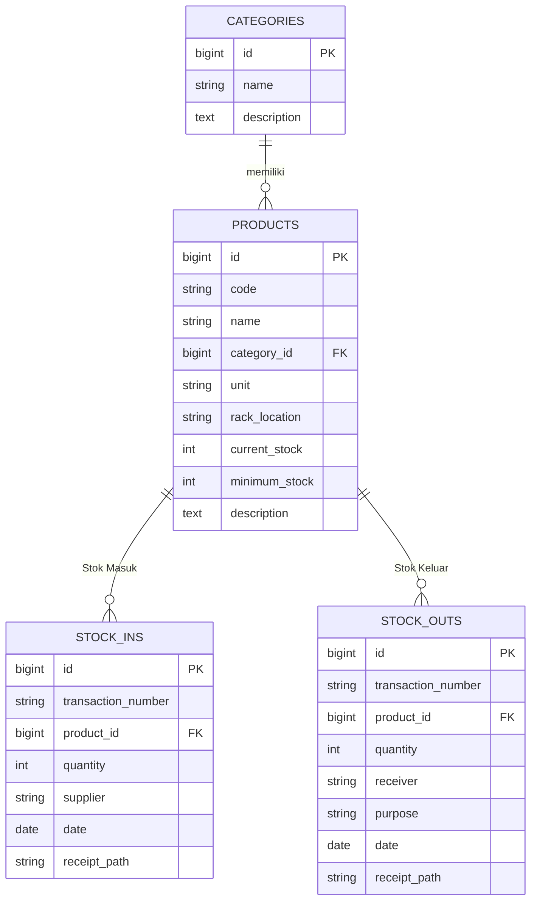

# Halaman Judul

**Laporan Warehouse Management System (WMS)**  
Dokumen teknis formal untuk kebutuhan dokumentasi sistem, UML, dan perancangan basis data.

# Lembar Pengesahan

Dokumen ini disusun sebagai artefak dokumentasi sistem **Warehouse Management System (WMS)** dan disetujui untuk digunakan sebagai referensi implementasi dan pengembangan lanjutan.

| Pihak | Nama | Tanggal | Tanda Tangan |
|---|---|---|---|
| Disusun oleh | Tim Pengembang WMS | 2026-08-01 | __________ |
| Diperiksa oleh | Koordinator Proyek | 2026-08-01 | __________ |
| Disetujui oleh | Pemilik Sistem | 2026-08-01 | __________ |

# Kata Pengantar

Puji syukur ke hadirat Tuhan Yang Maha Esa, dokumen ini disusun untuk memberikan gambaran menyeluruh mengenai sistem **Warehouse Management System (WMS)**. Dokumen meliputi ruang lingkup, arsitektur, UML, perancangan basis data, implementasi singkat, dan penutup.

Istilah yang digunakan secara konsisten pada dokumen ini adalah **Stok Masuk**, **Stok Keluar**, **Persediaan (Inventory)**, dan **Bukti Transaksi**.

# Daftar Isi

Daftar isi, daftar gambar, dan daftar tabel dihasilkan otomatis saat ekspor PDF menggunakan `pandoc` berdasarkan struktur heading dan caption dokumen.

# Daftar Gambar

Daftar gambar dihasilkan otomatis pada proses ekspor PDF dari diagram Mermaid dan elemen visual lainnya.

# Daftar Tabel

Daftar tabel dihasilkan otomatis pada proses ekspor PDF dari tabel yang terdapat pada dokumen.

# BAB I Pendahuluan

## 1.1 Latar Belakang

Operasional gudang membutuhkan pencatatan transaksi yang rapi, akurat, dan mudah diaudit. WMS dibangun untuk mengelola data produk, transaksi **Stok Masuk**, transaksi **Stok Keluar**, dan monitoring **Persediaan (Inventory)**.

## 1.2 Tujuan

1. Menyediakan pencatatan transaksi gudang yang terstruktur.
2. Menjaga akurasi stok aktual pada setiap produk.
3. Menyediakan jejak audit melalui **Bukti Transaksi**.

## 1.3 Ruang Lingkup

- Manajemen kategori dan produk.
- Proses **Stok Masuk** dan **Stok Keluar**.
- Monitoring **Persediaan (Inventory)** dan stok minimum.
- Laporan dan ekspor data.

# BAB II Gambaran Umum Sistem

## 2.1 Deskripsi Sistem

WMS adalah aplikasi berbasis web untuk aktivitas gudang meliputi master data, transaksi, monitoring, dan pelaporan.

## 2.2 Aktor Utama

- **Admin/Petugas Gudang**: mengelola data dan transaksi.
- **Pengguna Terautentikasi**: melihat dashboard, laporan, dan profil.

## 2.3 Modul Utama

1. Dashboard
2. Kategori
3. Produk
4. **Stok Masuk**
5. **Stok Keluar**
6. **Persediaan (Inventory)**
7. Laporan

# BAB III Arsitektur & UML

## 3.1 Arsitektur Singkat

Sistem menggunakan pola MVC, dengan komponen model, controller, view, dan basis data relasional.

## 3.2 Use Case Diagram

```mermaid
flowchart LR
    A[Admin/Petugas Gudang]

    UC1((Login))
    UC2((Kelola Kategori))
    UC3((Kelola Produk))
    UC4((Kelola Stok Masuk))
    UC5((Kelola Stok Keluar))
    UC6((Kelola Bukti Transaksi))
    UC7((Lihat Persediaan (Inventory)))
    UC8((Lihat dan Export Laporan))

    A --> UC1
    A --> UC2
    A --> UC3
    A --> UC4
    A --> UC5
    A --> UC6
    A --> UC7
    A --> UC8
```

## 3.3 Class Diagram



## 3.4 Activity Diagram Stok Masuk

```mermaid
flowchart TD
    S([Mulai]) --> A[Input data Stok Masuk]
    A --> B{Validasi data}
    B -- Tidak valid --> C[Perbaiki input]
    C --> A
    B -- Valid --> D[Simpan transaksi Stok Masuk]
    D --> E[Perbarui Persediaan (Inventory)]
    E --> F[Unggah Bukti Transaksi opsional]
    F --> G([Selesai])
```

## 3.5 Activity Diagram Stok Keluar

```mermaid
flowchart TD
    S([Mulai]) --> A[Input data Stok Keluar]
    A --> B{Validasi data}
    B -- Tidak valid --> C[Perbaiki input]
    C --> A
    B -- Valid --> D{Stok mencukupi}
    D -- Tidak --> E[Tolak transaksi]
    E --> A
    D -- Ya --> F[Simpan transaksi Stok Keluar]
    F --> G[Perbarui Persediaan (Inventory)]
    G --> H[Unggah Bukti Transaksi opsional]
    H --> I([Selesai])
```

## 3.6 Sequence Diagram Stok Masuk



## 3.7 Sequence Diagram Stok Keluar



# BAB IV Perancangan Basis Data

## 4.1 ERD Konseptual



## 4.2 Kamus Data Ringkas

| Tabel | Fungsi |
|---|---|
| `categories` | Master kategori barang |
| `products` | Master produk dan stok berjalan |
| `stock_ins` | Catatan transaksi **Stok Masuk** |
| `stock_outs` | Catatan transaksi **Stok Keluar** |

# BAB V Implementasi & Pengujian Singkat

## 5.1 Implementasi

Implementasi dilakukan pada modul master data, transaksi, dan pelaporan dengan validasi input untuk menjaga integritas data.

## 5.2 Pengujian Singkat

Pengujian fungsional singkat dilakukan pada skenario berikut:

1. Menambah transaksi **Stok Masuk** menambah nilai stok produk.
2. Menambah transaksi **Stok Keluar** mengurangi nilai stok produk jika stok mencukupi.
3. Unggah **Bukti Transaksi** tersimpan pada path yang tervalidasi.

# BAB VI Penutup

WMS membantu proses gudang menjadi lebih terukur melalui pencatatan transaksi, monitoring **Persediaan (Inventory)**, dan dokumentasi **Bukti Transaksi**. Dokumen ini dapat dijadikan dasar pengembangan tahap berikutnya.

# Lampiran

## Lampiran A — Istilah

- **Stok Masuk**: transaksi penambahan barang ke gudang.
- **Stok Keluar**: transaksi pengurangan barang dari gudang.
- **Persediaan (Inventory)**: jumlah stok terkini per produk.
- **Bukti Transaksi**: lampiran file pendukung transaksi.

## Lampiran B — Catatan Ekspor PDF

Gunakan script `scripts/export-pdf.sh` untuk menghasilkan berkas PDF dari dokumen ini.
